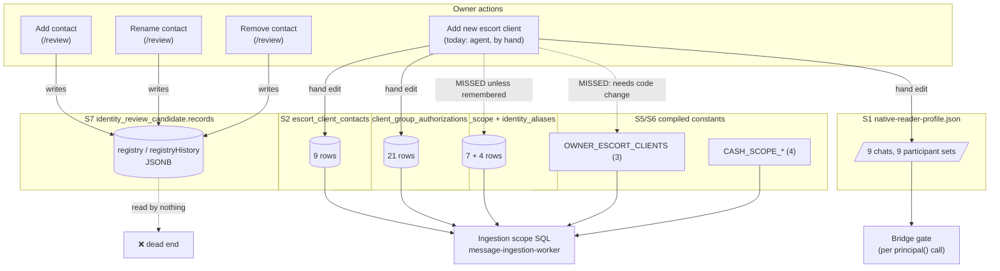
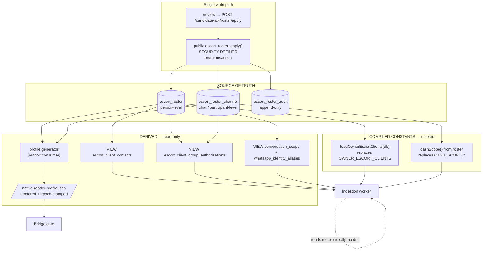

# Decisions (Owner-approved 2026-10-31)

1. **§7 — Chats restart:** KEEP THE DOCUMENTED 2s RESTART. Do not implement the asymmetric dynamic chats rule. Participant add/remove already dynamic (covers ~95%). Roster writer must emit `bridge_restart_required` flag when chats grows; deploy runbook handles 2s restart.
2. **§9 R6 — CASH_SCOPE_*:** CONFIRMED OUT OF SCOPE. No changes to cash constants. Separate phase after escort roster stable and freeze lifted.
3. **§3 — Source of truth:** CONFIRMED — promote `conversation_scope` + `whatsapp_identity_aliases` into normalized roster. No greenfield schema unrelated to them.
4. **§10 — First slice:** APPROVED — A → B → C → D1 first (~6 sessions). D2 (/review wiring deferred to second decision point) and E as second decision point after D1 stable in prod. Bridge JSON stays hand-maintained until D2.
5. **§11 Q5 — Authority split:** CONFIRMED — `identity_review_candidate.records` remains authority for identity decisions (evidence/verification/qualification). New `escort_roster` owns ingestion scope (who can send now). Separate concerns; verified != active and vice versa.

# Escort Roster Unification — Design Proposal

**Date:** 2026-10-31
**Status:** PROPOSAL — not approved, not committed, no code written
**Author:** Agent, for Owner review
**Supersedes nothing.** Companion to `docs/investigations/2026-10-31-review-backend-audit.md` and
`docs/investigations/2026-10-31-contact-sync-architecture.md`.

---

## 0. Correction to the prior audit (read first)

The audit reported **four** sources of truth. That was an undercount. Deeper inspection during this
design found **seven** representations of the same roster, two of which are already DB-driven and
already consumed by the ingestion worker:

| # | Representation | Kind | Rows today | Written at runtime by |
|---|---|---|---|---|
| S1 | `native-reader-profile.json` (bridge control file) | JSON file | 9 chats / 9 participant sets | **nothing** (hand-edited) |
| S2 | `public.escort_client_contacts` | table | 9 | **nothing** (hand SQL) |
| S3 | `public.escort_client_group_authorizations` | table | 21 | **nothing** (hand SQL) |
| S4a | `public.conversation_scope` | table | 7 | **nothing** (seeded) |
| S4b | `public.whatsapp_identity_aliases` | table | 4 | **nothing** (seeded) |
| S5 | `OWNER_ESCORT_CLIENTS` | hardcoded array | 3 | source code |
| S6 | `CASH_SCOPE_CHAT` / `CASH_SCOPE_CHAT_LID` / `CASH_SCOPE_ACCOUNTANT` / `CASH_SCOPE_OWNER` | hardcoded consts | 4 | source code |
| S7 | `identity_review_candidate.records` (owner registry) | JSONB blobs | — | **`/review` only** |

This makes the problem *worse* than reported but also **easier to solve than feared**, because S4a/S4b
are a sound DB-driven scope layer that already works. The design promotes S4 rather than replacing it.

### The decisive discovery: S1 is already 100 % derivable

Verified by exact set comparison against production today:

```
profile.chats  ==  conversation_scope.canonical_chat_jid ∪ alias_chat_jids   → IDENTICAL (9/9)
profile.participants[group] == escort_client_group_authorizations[group]     → IDENTICAL for all 3 groups
   120363408741101070@g.us  6 == 6
   120363426895117693@g.us  8 == 8
   120363428977781821@g.us  7 == 7
```

**The bridge profile contains no information that is not already in the database.** It is a
hand-maintained cache. That is the single most important fact in this document: S1 can be *generated*,
which turns an impossible "atomically update a file and a database" problem into an ordinary
"database is truth, file is a rendered artifact" problem.

---

## 1. Current state diagram



### Per-operation reality

| Operation | S1 profile | S2 contacts | S3 group authz | S4 scope | S5 list | S7 registry | Net effect |
|---|---|---|---|---|---|---|---|
| **Add contact via /review** | ✗ | ✗ | ✗ | ✗ | ✗ | ✓ | **Nothing ingests. Row exists in a table nothing reads.** |
| **Rename via /review** | ✗ | ✗ | ✗ | ✗ | ✗ | ✓ | **Register display unchanged.** |
| **Remove via /review** | ✗ | ✗ | ✗ | ✗ | ✗ | ✓ | **Ingestion continues unchanged — revocation does not happen.** |
| **Add new escort client (hand)** | manual | manual | manual | *often missed* | **needs code edit** | ✗ | Works only for group participants; a new **direct** client silently does not ingest. |

The last row is the dangerous one. A new direct-chat escort client requires S4a (a `conversation_scope`
row) **and** S1 (the chats list) **and** a bridge restart, because S4a is what produces the read list
and S1 is pinned at startup (§7).

---

## 2. Target state diagram

One write path. One table family. Everything else is derived or a view.



**Invariants of the target state**

1. Exactly one `INSERT`/`UPDATE` surface for roster data: `escort_roster_apply()`.
2. Every consumer either reads the roster tables directly or reads a **view** over them.
3. The JSON file is a rendered artifact with a monotonic `roster_epoch`; it is never hand-edited.
4. No escort client identifier appears in source code.
5. `/review` writes to the roster, not to a parallel registry.

---

## 3. Source of truth choice

### Decision: **(b) — a new table family, which absorbs S4 rather than replacing it.**

Not a greenfield schema: `conversation_scope` and `whatsapp_identity_aliases` are already the right
shape (person ref, chat jid, aliases, domain, saved name, profile name, verification). The proposal
promotes them into a normalized roster with versioning and audit, and turns the other six
representations into views or generated artifacts.

### Why not (a) `identity_review_candidate.records`

| Problem | Detail |
|---|---|
| No integrity | JSONB payload in a `(collection, id)` keyed table. No FKs, no CHECK constraints, no uniqueness on phone/chat/participant. |
| Wrong namespace | Schema is `identity_review_candidate` — a *qualification harness* namespace. The production review host happens to point at the same database, but the name signals its origin. |
| Consumer tax | Every ingestion query would have to parse JSONB and re-implement the zod validation in SQL. Ingestion runs on a 60 s loop; this is a real cost and a real bug surface. |
| Blast radius | `/review` is currently the only writer. Making a registry that a review UI owns into the authority for ingestion inverts the trust direction: a UI bug becomes an ingestion outage. |
| Strength it keeps | Its **validation** (`registrySchemas`), **versioning** (`expectedVersion`) and **audit** are excellent. The design **reuses the zod schemas as the API contract** and calls them before the SQL function — so we keep the good part without inheriting the storage. |

### Why not (c) keep `escort_client_contacts` as the source

- It is person-only. It has no notion of group, chat, participant, domain, alias, or PN↔LID mapping.
- `escort_client_group_authorizations` already exists as a *second* table precisely because S2 could
  not express group membership. Making S2 authoritative means permanently keeping two sources.
- It has no version column, no validity window, no audit.

### Trade-offs of (b), stated plainly

| Cost | Mitigation |
|---|---|
| Two new tables + a view layer to build and test | Phased plan §8; Phase A is additive and inert |
| Compatibility views can hide write attempts (`INSERT` into a view fails) | Views are read-only by design; the only writer is the function. `ir_review_runtime`'s stray `INSERT` grant on contacts is **revoked** in Phase D |
| Migration of 7 sources risks divergence | Phase B verifies byte-level equivalence before any reader switches |
| More moving parts than "just add a column" | But strictly fewer than the current 7 representations |

---

## 4. `OWNER_ESCORT_CLIENTS` decompilation

### Current

```js
// lib/escort-register.mjs:20
export const OWNER_ESCORT_CLIENTS = Object.freeze([
 {id:'escort-client-hridoy-wa01',       accountId:'wa-01', displayName:'Escort Hridoy',       username:'@nhhridoyvau', phone:'+8801670535255'},
 {id:'escort-client-rezaul-karim-wa01', accountId:'wa-01', displayName:'Escort REZAUL KARIM', username:null,           phone:'+8801836743754'},
 {id:'escort-client-tcis-wa01',         accountId:'wa-01', displayName:'TCIS W/A',            username:null,           phone:'+8801757622300'},
]);
```

Imported at `scripts/message-ingestion-worker.ts:7` and consumed in three SQL statements
(lines ~175, ~201–203) that decide which messages enter the `cash` and `vessel` queues.

### Replacement

**Reads from:** `public.escort_roster` joined to `public.escort_roster_channel`, filtered
`role='ESCORT_CLIENT' AND active=true AND domain='VESSEL'`, projected to the exact legacy shape
`{id, accountId, displayName, username, phone}` so **no call site changes**.

```ts
// lib/escort-register.mjs  (replaces the frozen array)
export async function loadOwnerEscortClients(db, {allowStaticFallback = false} = {}) { ... }
```

The function is async, so the three call sites change from a module constant to an awaited load —
one line each, executed once per ingestion cycle (already inside an async function).

### Migration

| Item | Detail |
|---|---|
| Migration | `00XX_escort_roster.sql`: create `escort_roster`, `escort_roster_channel`, `escort_roster_audit`, `escort_roster_apply()`, and the four compatibility views. |
| Seed | Backfill from the four existing sources (Phase B), including the 6 contacts that exist only in S2 (Sahil, Alim, Al-Aqsa, Jasim, Faruk, Sezan) and the 3 that exist only in S5. |
| Note | S5 has 3, S2 has 9, S4a has 3 escort directs. The union is 9 escorts. The seed must **union**, not pick one, or 6 clients vanish. |

### Backward compatibility during cutover (no misrouted in-flight message)

Controlled by one env var, `ALRIFAI_ROSTER_SOURCE`, read once per cycle:

| Value | Behaviour |
|---|---|
| `STATIC` (default, Phase A/B) | Today's frozen array. Zero behaviour change. |
| `SHADOW` (Phase C) | Loads from DB, compares against the static array, logs any difference, **still uses STATIC for routing**. Proves equivalence in production without risk. |
| `DB` (Phase D) | Uses the DB result. Static array deleted. |

`SHADOW` is the key safety device: it lets us run the new query against live data for days and prove
that it returns the same 3 rows before it is allowed to decide anything.

### If the query fails

| Phase | Behaviour | Rationale |
|---|---|---|
| C (`SHADOW`) | falls back to STATIC, logs `ROSTER_DB_UNAVAILABLE`, increments a counter | Routing must not change while we are only observing |
| D (first deploy) | falls back to STATIC, **loud error**, health degrades | Avoid an ingestion outage on a transient DB blip |
| D + 1 (steady state) | **fails closed**: throws, the cycle aborts, `last_error` is set per chat | An empty roster must never silently re-enable a stale compiled list — that is how messages get misrouted months later |

Explicitly rejected: **fail open with an empty set**. An empty `OWNER_ESCORT_CLIENTS` would make the
`NOT EXISTS` subquery in the cash rule match everything — i.e. it would route *more* messages, not
fewer. That is the single most dangerous failure mode in this area and must be a hard guard:
`if (!clients.length) throw new Error('ROSTER_EMPTY')` before any query runs.

---

## 5. Atomic write design

### The problem, stated honestly

A PostgreSQL transaction cannot include a filesystem write. `rename(2)` is atomic but cannot be rolled
back. Therefore **true** cross-store atomicity between the DB and the JSON file is impossible. The
design's job is to make the residual window *observable, bounded and self-healing* rather than pretend
it does not exist.

### Options considered

| Option | Verdict |
|---|---|
| **Write the JSON inside the DB transaction** (trigger → `COPY TO`, or `pg_notify` + watcher) | **Rejected.** A trigger cannot write outside the DB. `pg_notify` is delivered only *after* commit, so the writer is still outside the transaction. Holding a transaction open across `fsync` is unacceptable. |
| **Bridge reads the DB directly** (delete the file) | **Rejected for now.** The MCP server runs as UID 10002 and holds no PostgreSQL credential by design; giving it one widens the bridge's privilege surface and its blast radius. Worth revisiting only if drift proves unmanageable. |
| **Two-phase: DB commit → render → atomic rename → verify; drift detector repairs** | **RECOMMENDED.** |

### Recommended design: transactional outbox + deterministic renderer

```
┌─ ONE DB TRANSACTION ──────────────────────────────────────────────┐
│ SELECT public.escort_roster_apply(actor, kind, payload, expected) │
│   ├─ validate expectedVersion  (409 on mismatch)                  │
│   ├─ write escort_roster / escort_roster_channel                  │
│   ├─ append escort_roster_audit                                   │
│   ├─ roster_epoch := roster_epoch + 1                             │
│   └─ INSERT INTO escort_roster_outbox(epoch)                      │
└───────────────────────────────┬───────────────────────────────────┘
                                │ COMMIT  (truth is now durable)
                                ▼
              ┌─────────────────────────────────────┐
              │ profile generator (app worker tick) │
              │  claim outbox row FOR UPDATE        │
              │    SKIP LOCKED                      │
              │  render FULL profile from roster    │
              │  (deterministic: sorted keys/JIDs)  │
              │  write profile.json.tmp             │
              │  fsync(tmp)                         │
              │  rename(tmp, profile.json)  ← atomic│
              │  record epoch + sha256 in outbox    │
              └─────────────────────────────────────┘
```

**Why the renderer must be deterministic:** if the render is a pure function of committed state, then
re-running it is idempotent, two concurrent generators cannot disagree, and the on-disk `sha256` is a
verifiable proof that the file matches a specific `roster_epoch`. Sorted key order and sorted JID
lists are mandatory, not stylistic.

**Drift detection (the safety net).** Every ingestion cycle compares
`sha256(rendered(roster_epoch))` against the `sha256` recorded for the file on disk. On mismatch it
logs `ROSTER_PROFILE_DRIFT` with both epochs and re-renders. This converts the unavoidable window into
a self-healing condition with an audit trail.

### Failure modes

| # | Failure | Consequence | Detection | Recovery |
|---|---|---|---|---|
| F1 | DB commits, generator never runs | Bridge uses stale profile; a newly authorized sender is denied; a revoked sender is still admitted | `ROSTER_PROFILE_DRIFT` (epoch mismatch), outbox age metric | Generator is idempotent; next tick fixes it. Bounded by tick interval. |
| F2 | Generator dies mid-write | **No effect** — the temp file is never renamed; the old profile stays valid | stale temp file | Next tick overwrites temp |
| F3 | Generator writes, DB later rolled back | **Impossible** — the generator only reads committed state | — | — |
| F4 | Two generators race | Both render identical bytes (deterministic); last rename wins, same content | outbox claim prevents duplicate work | — |
| F5 | Disk full during render | Temp write fails, rename never happens, old profile intact | `ENOSPC` log, health degrades | Free space; retry |
| F6 | Malformed profile written | Bridge fails **closed** (`NATIVE_PROFILE_DENIED` / `NATIVE_ACCESS_DENIED`) → ingestion stops | immediate, loud | Renderer validates against the JSON schema *before* rename; a failing render never replaces a good file |
| F7 | Operator hand-edits the file | Overwritten at next render | drift detector | Documented as forbidden; file mode 440 root-owned already discourages it |

**F6 mitigation is the important one:** the renderer must validate its own output against the exact
schema the bridge enforces *before* the rename. A file that would fail the bridge's load must never
reach disk. This makes F6 unreachable by construction.

---

## 6. `/review` UI impact — minimal

**The forms already exist and are reusable.** `ManagementWorkspace.tsx` already renders editors for
`person`, `relationship`, `binding` and `group`, with `Add new`, `active`, `reason` and
`expectedVersion` already wired. The gap is **backend routing, not UI**.

Minimum change:

1. **One new option** in the existing `<select>`: `roster` — "Escort roster (live)".
   One `<option>` line.
2. **One new form branch** reusing existing inputs: person ref, display name, phone, role, and a
   channel sub-list (chat JID, participant JID, domain). Reuses the existing field markup.
3. **One new fetch** to `POST /candidate-api/roster/apply` — a near-copy of the existing management
   `POST`, same CSRF header, same `expectedVersion`.
4. **Read-only derived badges** on the existing roster list: "in bridge profile ✓ / ✗", "in ingestion
   scope ✓ / ✗", `roster_epoch`. This is what makes the fix *visible* — without it the operator
   cannot tell whether a write propagated.

That is roughly one form branch plus one list column. No redesign, no new navigation, no i18n work.

**Explicitly out of scope** (confirmed by Owner): UX overhaul, layout, Bengali copy review, mobile.

---

## 7. Bridge restart avoidance

### Current behaviour (verified)

`native_profile.py` `principal()` re-reads the file on **every** call, then enforces:

```python
if scope.get("chats") != chats or not isinstance(scope.get("epoch"), int) or scope["epoch"] < 1:
    raise NativeReadError("NATIVE_ACCESS_REVOKED")
```

- `participants` → read fresh → **participant add/remove is already dynamic, no restart** (proven in
  production on 2026-10-31: effective within one 15 s poll cycle).
- `chats` → compared against the value captured at process start → **any change fails closed** until
  the MCP child restarts.

### Can `chats` become dynamic safely? Yes, with an asymmetric rule.

The `chats` pin is TOCTOU hardening: it stops a profile swap from widening read scope under an
already-authorized principal. But the file is `440 root:root`-owned in a `0710` control directory, so
"an attacker can swap it" is already constrained to root. The pin mostly costs operability.

**Recommended: asymmetric re-read.**

| Change | Behaviour | Rationale |
|---|---|---|
| Participant added/removed | immediate (already true) | roster churn must be instant |
| Chat **removed** from `chats` | **immediate** — new principal() returns the smaller set | revocation must never wait for a restart |
| Chat **added** to `chats` | accepted **only if** `profile.roster_epoch > startup_epoch` **and** the file is still root-owned and not group/world-writable | expansion is the privileged direction, so it needs a monotonic, auditable marker |

Concretely: replace the equality check with

```python
if scope.get("chats") != chats:
    grew = set(scope.get("chats") or ()) > set(chats)          # strict superset
    shrunk = set(scope.get("chats") or ()) < set(chats)        # strict subset
    if shrunk or (grew and current.get("roster_epoch", 0) > p.get("roster_epoch", 0)):
        chats = scope["chats"]        # adopt, and keep the new baseline
    else:
        raise NativeReadError("NATIVE_ACCESS_REVOKED")
```

Plus: keep the existing ownership/mode/size checks, and add `roster_epoch` to the profile schema so the
gate has something monotonic to compare.

**If the Owner prefers minimum change:** do not touch the gate. Instead document the restart as a
first-class, automated step: the roster writer emits a `bridge_restart_required` flag when `chats`
grows, and the deploy runbook performs the 2-second `docker compose up -d --no-deps whatsapp-wa-01`.
This is operationally acceptable (2 s, session survives via the bind-mounted store) but it is a manual
coupling and should be the fallback, not the design.

---

## 8. Migration plan

Every phase is independently deployable and reversible. **No phase changes routing behaviour until
Phase D**, and Phase D is gated on Phase C having produced zero discrepancies for a sustained period.

### Phase A — Create the roster schema (no behaviour change)

| | |
|---|---|
| **Scope** | Migration adds `escort_roster`, `escort_roster_channel`, `escort_roster_audit`, `escort_roster_epoch`, `escort_roster_outbox`, `escort_roster_apply()`. Nothing reads them. No view yet. |
| **Risk** | Low — purely additive. Ledger row 37. |
| **Rollback** | `DROP` the new objects (nothing depends on them). Pre-migration `pg_dump`. |
| **Verify** | Migration applies on a restored copy first; ledger 36→37; existing queries byte-identical; ingestion cycle unaffected; `0` new error classes in the log diff. |

### Phase B — Backfill and prove equivalence

| | |
|---|---|
| **Scope** | Seed roster from the **union** of S1, S2, S3, S4a, S4b, S5. Create the four compatibility views. Build a verification script that asserts view output == legacy table output for every row. |
| **Risk** | Medium — the union is the trap: 6 escorts exist only in S2, 3 only in S5. |
| **Rollback** | Drop the views and the seeded rows; legacy tables untouched throughout (this is why the views are created *after* the backfill and the tables are never dropped here). |
| **Verify** | `escort_client_contacts` view ≡ legacy (9/9 rows, column-for-column); group-authz view ≡ legacy (21/21); `conversation_scope` view ≡ legacy (7/7); rendered profile from roster is **byte-identical** to today's `native-reader-profile.json` (this is provable — §0). |

### Phase C — Switch readers to `SHADOW`

| | |
|---|---|
| **Scope** | Ingestion worker loads roster alongside the legacy path and compares every cycle, logging `ROSTER_SHADOW_DIFF`. **Routing still uses legacy.** Bridge untouched. |
| **Risk** | Very low — observation only. |
| **Rollback** | Set `ALRIFAI_ROSTER_SOURCE=STATIC`. No deploy needed. |
| **Verify** | `ROSTER_SHADOW_DIFF` count = 0 for ≥ 72 h including at least one real roster event. |

**Order matters here.** The **app switches first, the bridge last.** The app can be shadowed safely and
rolled back with one env var; the bridge cannot (it is a container swap). Also, the app's roster query
is the thing most likely to have a bug, so it must be proven before the bridge is allowed to depend on
the same data.

### Phase D — Cut readers over

| | |
|---|---|
| **D1** | App: `ALRIFAI_ROSTER_SOURCE=DB`. `OWNER_ESCORT_CLIENTS` and `CASH_SCOPE_*` deleted from source. Ingestion scope reads views. |
| **D2** | Bridge: profile becomes a **generated artifact** (outbox + renderer + drift detector). `native-reader-profile.json` becomes machine-owned; hand-editing is retired. |
| **Risk** | Medium–High. This is the only phase that can stop ingestion. |
| **Rollback** | D1: revert the commit + redeploy the previous app image (`1d4602c3…` retained). D2: stop the renderer, restore the pre-generated profile from the backup copy, restart the bridge on `ae009303…`. Cursor advances are not rewound (documented, accepted). |
| **Verify** | 9/9 chats ingesting; `last_error` NULL on all; 0 new log error classes; rendered profile sha256 stable across 10 consecutive ticks; forced-failure drill (kill the generator, confirm drift alert fires and self-heals). |

### Phase E — Wire `/review` to the roster and decommission

| | |
|---|---|
| **Scope** | Add `roster` kind + `POST /candidate-api/roster/apply`; add derived badges. Revoke `ir_review_runtime`'s stray `INSERT` on contacts. Retire `identity_review_candidate.records` as a roster authority (keep it for its other purposes). Drop the legacy tables, converting the compatibility views into the real objects. |
| **Risk** | Medium — UI writes to a new path. |
| **Rollback** | Feature-flag the new `roster` kind off; the old management tab still writes the registry (harmless, just not authoritative). |
| **Verify** | End-to-end: add a contact in `/review` → row in roster → appears in the generated profile → next poll ingests. Rename → register display updates. Remove → sender denied within one cycle. All three proven in a rehearsal database first. |

---

## 9. Risk register

| # | Risk | Likelihood | Impact | Mitigation |
|---|---|---|---|---|
| R1 | **Data loss during migration** — the union is mis-specified and 6 escorts (S2-only) or 3 (S5-only) are dropped | **Medium** | **High** — messages stop being classified, silently | Phase B asserts row-count equality against *each* source separately, not just the total. `pg_dump` before every phase. The views are created only after the count assertions pass. |
| R2 | **Split brain between DB and JSON during cutover** | **High** (inherent — §5) | Medium — denials or stale admissions for one tick | Deterministic renderer + `roster_epoch` + drift detector. Residual window bounded by the worker tick and *observable*, not silent. |
| R3 | **Bridge fails closed on a bad profile** — malformed JSON stops all ingestion | Medium | **High** — full WA-01 outage | Renderer validates against the bridge's exact schema **before** rename; `tmp`+`fsync`+`rename` means a bad render never replaces a good file; pre-generated profile backup retained for instant restore; rollback image `ae009303…` retained. |
| R4 | **Hardcoded-list removal breaks a code path we did not find** | **Medium** | Medium–High | Phase C `SHADOW` mode compares DB output to the static array on **every** cycle for ≥72 h. Additionally grep every importer of `escort-register.mjs` (currently one worker plus tests) and add a static test that asserts no escort phone number literal exists anywhere in `apps/al-rifai/**`. |
| R5 | **`/review` silently writes to the wrong place** | Medium | Medium — operator believes a change took effect | Derived badges (§6) make propagation visible; `expectedVersion` surfaces conflicts; a test asserts `POST /roster/apply` produces a roster row **and** a changed rendered profile sha256. |
| R6 | Cash scope regression — `CASH_SCOPE_*` removal misfires and cash messages route to vessel or vice versa | Low–Medium | **High** — financial misclassification | Cash scope is out of the *escort* roster; keep `CASH_SCOPE_*` as a separate, later change. **Recommendation: defer S6 to its own phase.** Cash is frozen and must not be touched casually. |
| R7 | Profile file ownership/mode regression (the gate fails closed on `mode & 0o022`) | Low | High | Renderer writes with `0600` then `chown root:whatsapp-wa-01` + `chmod 0440`; a test asserts the final mode/owner; the existing guard already fails closed. |

**Recommended scope reduction:** R6 is the reason I recommend **not** touching `CASH_SCOPE_*` in this
work. Unify the *escort* roster; leave cash constants alone until the escort path is stable and the
freeze is lifted. This drops one high-severity risk for near-zero cost.

---

## 10. Effort estimate

"Sessions" = one working session with an Owner checkpoint. Estimates assume no surprises in the
rehearsal database.

| Phase | Size | What fits in it |
|---|---|---|
| A — schema | **Small** (1) | Migration + rehearsal on a restored dump + ledger row + rollback proof |
| B — backfill + views | **Medium** (2–3) | Union seed, 4 views, equivalence harness, byte-identical profile proof. *The harness is the bulk of the work, not the SQL.* |
| C — shadow | **Small** (1) + **72 h observation** | Env flag, diff logging, a dashboard query. Mostly waiting. |
| D1 — app cutover | **Medium** (2) | Async roster loader, 3 call-site changes, static-number guard test, TAP-gated deploy |
| D2 — bridge cutover | **Large** (3–4) | Outbox, deterministic renderer, schema validation, drift detector, ownership/mode handling, forced-failure drill, TAP-gated bridge deploy |
| E — /review + decommission | **Medium** (2–3) | One form branch, one endpoint, badges, grant revocation, legacy drop |
| **Total** | **Large — 11–14 sessions** | |

### What can be deferred

| Deferrable | Why |
|---|---|
| **S6 `CASH_SCOPE_*`** | Cash is frozen; removing these adds a high-severity financial risk for little gain. Own phase, later. |
| **`/review` UI beyond the minimum** | Owner-confirmed out of scope. Phase E's badges are the floor. |
| **Contact-name sync from `get_contact`** | Once the roster is authoritative, a name-sync job is a small add-on. It should be built *on top of* the roster, never beside it. |
| **Dynamic `chats` re-read (§7)** | If the Owner accepts a documented 2 s restart on new-client addition, §7 can be deferred entirely. This removes ~1 session from D2. |
| **Dropping legacy tables** | The compatibility views can live indefinitely; physically dropping the old tables is cosmetic and can wait until confidence is high. |

### Recommended minimum viable slice

**A → B → C → D1** delivers the highest-value outcome for ~6 sessions: the escort list stops being
hardcoded, the roster becomes queryable and versioned, and no new client can be silently missed. The
bridge JSON remains hand-maintained (status quo) until D2. That is a defensible stopping point if
priorities shift.

---

## 11. Open questions for the Owner

1. **§7** — accept the asymmetric dynamic `chats` rule, or keep the documented 2 s restart?
2. **§9 R6** — confirm `CASH_SCOPE_*` is out of scope for this work (recommended).
3. **§3** — confirm promoting `conversation_scope` into the roster, rather than a greenfield schema
   unrelated to it.
4. **§10** — approve the A→B→C→D1 slice as the first deliverable, with D2/E as a second decision point?
5. **`/review` authority** — after Phase E, should `identity_review_candidate.records` remain the
   authority for *identity decisions* (who is a person, what evidence) while the roster owns *ingestion
   scope*? My recommendation: **yes, keep them separate concerns** — decisions are evidence, roster is
   operational state.

---

*End of proposal. Not committed. No code, migration, deploy or data change was made in producing it.*
